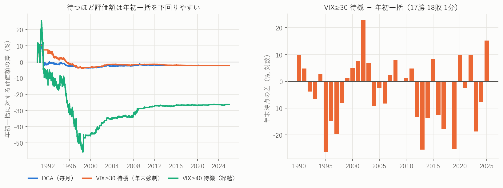
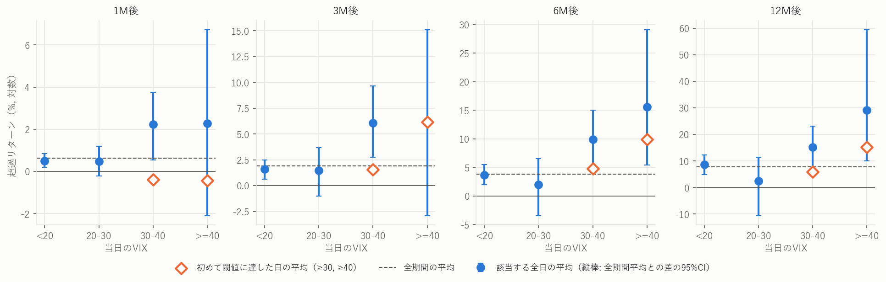
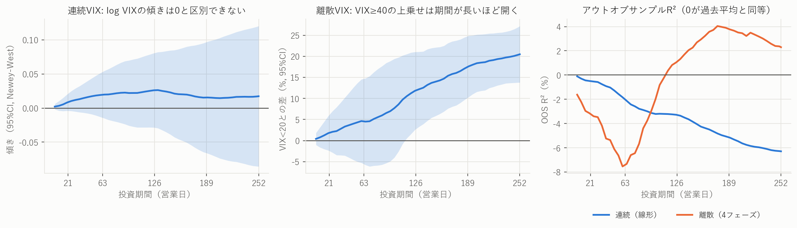
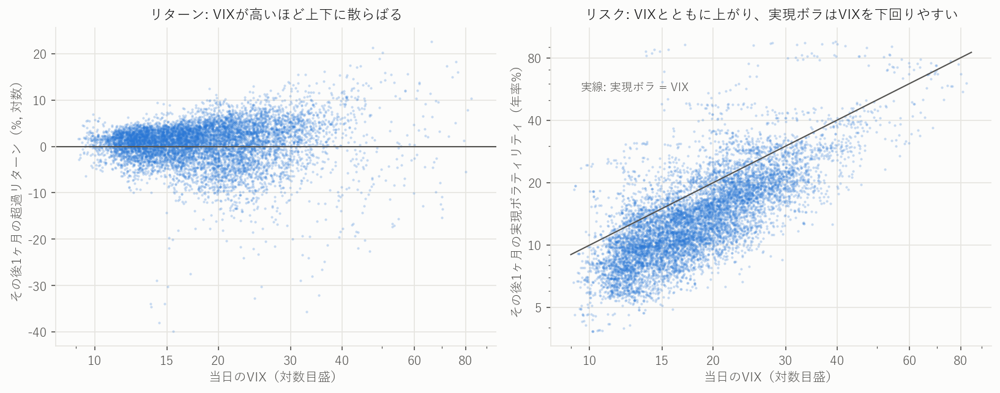
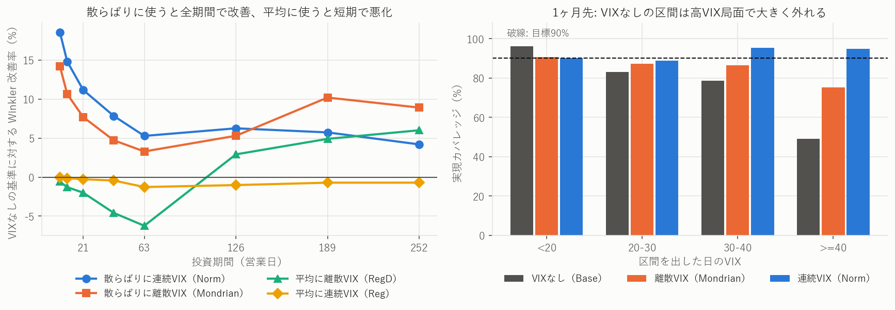
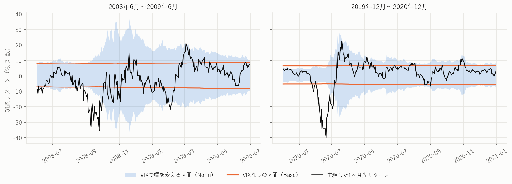

# VIXはS&P500のリターンにどの程度影響するか

シグナル投資の比較から、回帰分析、コンフォーマル予測まで（1990-01-02〜2025-12-31）

> このレポートの数値はすべて `results/` のCSVから `build_report.py` が差し込んでいます。文章中の定性的な主張も、データと合わなくなると生成が止まるようにしています。実装と本文の作成にはAI（Claude）を使用しました。統計的な検証であり、個別の投資助言ではありません。

## 1. 結論

**VIXはリターンの水準よりも、リスクの大きさをよく説明します。VIXを見て買うタイミングを選んでも、年初一括やDCAを上回る証拠は得られませんでした。一方、予測区間の幅に使うと、特に短期で精度が上がります。**

| 戦略 | IRR | TWR-CAGR | リスク（ボラ） | Sharpe | 最大DD |
|---|---|---|---|---|---|
| 年初一括 | 10.78% | 10.75% | 18.05% | 0.504 | -55.3% |
| DCA(毎月) | 10.68% | 10.72% | 17.65% | 0.511 | -54.6% |
| 一括+DCA | 10.73% | 10.74% | 17.83% | 0.508 | -54.9% |
| VIX≥30 待機(年末強制) | 10.69% | 10.89% | 17.75% | 0.517 | -55.2% |
| VIX≥40 待機(繰越) | 9.55% | 8.45% | 16.18% | 0.413 | -52.5% |
| 一括+DCA+VIX≥30 | 10.72% | 10.79% | 17.79% | 0.511 | -55.0% |
| 一括+DCA+VIX≥30(繰越) | 10.54% | 10.53% | 17.67% | 0.500 | -55.0% |

全戦略で期間と外部キャッシュフローを揃えています。積立ではCAGRが資金の入るタイミングを反映しないため、投資家の収益率としてIRRも併記します。

1. **投資戦略としての上乗せは確認できません。** IRRは年初一括 10.78% が全戦略で最大です。年初一括・DCA・VIX待機資金を組み合わせたアンサンブルは 10.72%（繰越 10.54%）で、構成要素の中間に収まります。差はプラセボと区別できません。
2. **シグナルの情報は極端域に限られます。** VIX≥40の12M平均は全日で 29.16% ですが、初めて到達した日に買うと 15.11%（9件）に下がります。VIX≥30の初回到達の12M平均は全期間平均を下回ります。
3. **回帰での寄与は小さく、不安定です。** log VIXの線形回帰のR²は最大 0.81%、OOS R²は全期間で負です。離散モデルの標本内R²は12Mで 9.13% に達しますが、標本外では危機を除くと負になります。
4. **リスクへの説明力は強いです。** 翌期間の実現ボラに対するR²は 26.7〜54.9% です。
5. **コンフォーマル予測は「幅に使う」と機能します。** 1M先のWinklerはNormで 11.2% 改善し（差のCIは0を除外）、VIX≥40でのカバレッジは 49.2% から 94.7% に上がります。平均に使っても改善せず、ショックの初動も捉えられず、ACIもこの設定では改善しません。

## 2. 研究の設計

### 2.1 問いの分解

| 段階 | 問い | 主な指標 |
|---|---|---|
| 1 | VIXをシグナルに投資するとどうなるか | IRR、CAGR、ボラ、Sharpe、最大DD |
| 2 | シグナルとして機能しているか | 局面別リターン、初回到達、プラセボ |
| 3 | リターンにどの程度寄与するか | 回帰係数、R²、OOS R² |
| 4 | 予測の不確実性の評価に使えるか | Winkler、カバレッジ |

### 2.2 離散と連続の扱い

- **VIX:** 離散は4局面（<20、20-30、30-40、≥40）、連続はlog VIXです。第1段階のシグナルは運用ルールとして明快なので離散にしています。閾値はデータを見る前に登録したものではなく、キリの良い値として選んだものです。
- **投資期間:** 離散は1M/3M/6M/12M（21/63/126/252営業日）、連続は5〜252営業日のグリッドです。

### 2.3 データと執行

- **データ:** `^SP500TR`（配当込み）、`^VIX`、`^IRX`（T-bill）。取得日は2026-11-07です。原データと日次系列はリポジトリに含めません（`DATA_POLICY.md`）。
- **執行:** t日のVIX終値で判定し、**t+1日の終値で執行**します。VIXの確定（16:15ET）が指数の確定（16:00ET）より遅いため、同日執行だと先読みになります。将来リターンもt+1日終値を起点にしています。

## 3. 第1段階: VIXをシグナルに投資するとリターンはどうなるか

### 3.1 資金投入型: 毎年の資金をいつ株式に入れるか

全戦略で評価期間（1990-01-02〜2025-12-31、9,067営業日）と外部キャッシュフロー（毎年初に1単位、計36単位）を揃えています。違うのは、届いた資金をいつ株式へ投じるかだけです。未投資分はT-billで運用します。

- **VIX待機（年末強制）:** 年内にVIXが閾値に達したら翌営業日に投資し、達しなければ年末に投資する
- **VIX待機（繰越）:** 閾値に達するまで翌年以降も待つ
- **アンサンブル:** 構成要素に予算を等分する。`一括+DCA+VIX≥30` なら、毎年の資金の1/3を年初に投資し、1/3を毎月積み立て、残り1/3をVIX待機資金にする

| 戦略 | 最終倍率 | IRR | TWR-CAGR | ボラ | Sharpe | 最大DD | 平均株式比率 |
|---|---|---|---|---|---|---|---|
| 年初一括 | 11.08 | 10.78% | 10.75% | 18.05% | 0.504 | -55.3% | 100.0% |
| DCA(毎月) | 10.82 | 10.68% | 10.72% | 17.65% | 0.511 | -54.6% | 96.2% |
| 一括+DCA | 10.95 | 10.73% | 10.74% | 17.83% | 0.508 | -54.9% | 98.1% |
| VIX≥20 待機(年末強制) | 10.92 | 10.72% | 10.71% | 17.98% | 0.504 | -55.3% | 98.5% |
| VIX≥30 待機(年末強制) | 10.83 | 10.69% | 10.89% | 17.75% | 0.517 | -55.2% | 95.1% |
| VIX≥40 待機(年末強制) | 10.59 | 10.60% | 10.58% | 17.40% | 0.508 | -55.0% | 92.1% |
| VIX≥20 待機(繰越) | 10.96 | 10.73% | 10.74% | 17.97% | 0.506 | -55.3% | 98.3% |
| VIX≥30 待機(繰越) | 9.41 | 10.12% | 10.03% | 17.39% | 0.479 | -55.2% | 89.4% |
| VIX≥40 待機(繰越) | 8.17 | 9.55% | 8.45% | 16.18% | 0.413 | -52.5% | 71.8% |
| 一括+VIX≥20 | 11.00 | 10.75% | 10.73% | 18.02% | 0.504 | -55.3% | 99.2% |
| 一括+VIX≥30 | 10.96 | 10.73% | 10.82% | 17.87% | 0.511 | -55.2% | 97.5% |
| 一括+VIX≥40 | 10.84 | 10.69% | 10.67% | 17.67% | 0.508 | -55.1% | 96.0% |
| DCA+VIX≥20 | 10.87 | 10.70% | 10.72% | 17.80% | 0.508 | -54.9% | 97.4% |
| DCA+VIX≥30 | 10.83 | 10.69% | 10.81% | 17.69% | 0.514 | -54.9% | 95.7% |
| DCA+VIX≥40 | 10.71 | 10.64% | 10.65% | 17.50% | 0.510 | -54.8% | 94.2% |
| 一括+DCA+VIX≥20 | 10.94 | 10.73% | 10.73% | 17.88% | 0.507 | -55.0% | 98.2% |
| 一括+DCA+VIX≥30 | 10.91 | 10.72% | 10.79% | 17.79% | 0.511 | -55.0% | 97.1% |
| 一括+DCA+VIX≥40 | 10.83 | 10.69% | 10.69% | 17.65% | 0.509 | -55.0% | 96.1% |
| 一括+DCA+VIX≥20(繰越) | 10.95 | 10.73% | 10.74% | 17.87% | 0.507 | -55.0% | 98.2% |
| 一括+DCA+VIX≥30(繰越) | 10.44 | 10.54% | 10.53% | 17.67% | 0.500 | -55.0% | 95.3% |
| 一括+DCA+VIX≥40(繰越) | 10.02 | 10.38% | 10.12% | 17.21% | 0.487 | -54.3% | 90.8% |

シグナルの発火は、VIX≥20は32/36年（平均待機53日）、VIX≥30は21/36年（平均待機151日）、VIX≥40は10/36年（平均待機214日）でした。

**読み取り:**

- 外部フローを揃えた収益率であるIRRと最終倍率は、年初一括が全戦略で最大です（10.78%、11.08倍）。
- ボラは年初一括が最大で、他はわずかに下がります。その結果Sharpeは 0.413〜0.517 に収まり、最大は `VIX≥30 待機(年末強制)` の 0.517 です。ただし次節のとおり偶然と区別できません。
- 最大DDは、繰越の大きいケースを除くとほぼ同水準です。積立が進むと資産の大半が株式になるため、新規資金のタイミングでは大きな下落を避けられません。
- `VIX≥30 年末強制` はIRRが年初一括を下回るのに、TWR-CAGRは上回ります（10.89% 対 10.75%）。TWRは運用額の大小によらず各日を同じ重みで数えるため、現金比率が高い積立初期の影響を受けやすいと考えられます。積み立てる投資家の実感に近いのはIRRなので、判断にはIRRを使います。

### 3.2 待機資金を組み込んだアンサンブル

年初一括・月次DCA・VIX待機資金の組み合わせを、待機資金の比率を変えて確認しました。各セルは IRR / Sharpe です。比率は最良値を選ぶためでなく、結論が比率に左右されるかを見るためのものです。比率以外の予算は年初一括とDCAに半分ずつ割り当てます。

| 待機資金の条件 | 比率10% | 比率20% | 比率33% | 比率50% |
|---|---|---|---|---|
| VIX≥20 年末強制 | 10.73% / 0.508 | 10.73% / 0.507 | 10.73% / 0.507 | 10.73% / 0.506 |
| VIX≥20 繰越 | 10.73% / 0.508 | 10.73% / 0.508 | 10.73% / 0.507 | 10.73% / 0.507 |
| VIX≥30 年末強制 | 10.73% / 0.509 | 10.72% / 0.510 | 10.72% / 0.511 | 10.71% / 0.513 |
| VIX≥30 繰越 | 10.67% / 0.506 | 10.62% / 0.504 | 10.54% / 0.500 | 10.44% / 0.496 |
| VIX≥40 年末強制 | 10.72% / 0.508 | 10.70% / 0.509 | 10.69% / 0.509 | 10.66% / 0.509 |
| VIX≥40 繰越 | 10.63% / 0.503 | 10.52% / 0.497 | 10.38% / 0.487 | 10.18% / 0.474 |

比較対象は年初一括（10.78% / 0.504）、DCA（10.68% / 0.511）、一括+DCA（10.73% / 0.508）です。

- **IRR:** 全24ケースで年初一括を下回りました。
- **繰越:** VIX≥30とVIX≥40では、待機比率を上げるほどIRRが下がります。資金を翌年へ持ち越すと、待つコストが積み上がるためです。
- **年末強制:** 1/3待機のVIX≥30は、IRR 10.72%、Sharpe 0.511、最大DD -55.0%です。IRRは年初一括とDCAの間にあり、Sharpeは両者をわずかに上回りますが、次節のとおりプラセボと区別できません（p=0.254）。同じ条件の繰越版は IRR 10.54%、Sharpe 0.500 です。
- **解釈:** アンサンブルの評価額は、構成要素の評価額の加重和です（テストで確認済み）。そのため最終評価額は必ず構成要素の範囲に収まり、組み合わせからリターンの上乗せは生まれません。

### 3.3 差は偶然と区別できるか

1年ごとに投入した資金の年末価値を比べました（ビンテージ分析）。年が重ならないため、独立に近い36標本として扱えます。値は対数差で、差が0の年（シグナルが既に点灯していて買付日が同じになった年など）は符号検定から除きます。

| 戦略 | 対 年初一括（%, 95%CI） | 年ごとの勝敗 | 符号検定p | 対 DCA（%, 95%CI） |
|---|---|---|---|---|
| DCA(毎月) | -2.49 [-4.94, +0.23] | 11勝25敗0分 | 0.029 | — |
| 一括+DCA | -1.16 [-2.36, +0.10] | 11勝25敗0分 | 0.029 | +1.33 [+0.01, +2.60] |
| VIX≥20 待機(年末強制) | -1.32 [-3.45, +0.40] | 9勝12敗15分 | 0.664 | +1.17 [-1.37, +3.76] |
| VIX≥30 待機(年末強制) | -3.22 [-7.16, +0.66] | 17勝18敗1分 | 1.000 | -0.73 [-3.37, +2.10] |
| VIX≥40 待機(年末強制) | -4.20 [-9.58, +1.22] | 13勝22敗1分 | 0.175 | -1.71 [-4.84, +1.46] |
| 一括+DCA+VIX≥20 | -1.18 [-2.46, +0.00] | 12勝24敗0分 | 0.065 | +1.31 [-0.38, +2.84] |
| 一括+DCA+VIX≥30 | -1.74 [-3.67, +0.26] | 14勝22敗0分 | 0.243 | +0.74 [-0.44, +1.86] |
| 一括+DCA+VIX≥40 | -1.98 [-4.47, +0.58] | 13勝23敗0分 | 0.132 | +0.51 [-0.19, +1.33] |

次に、VIX系列を循環シフトしたプラセボ（1,713通り）と比べました。発火の塊の形を保ったまま、市場との対応だけを壊す検定です。「族補正」は6ルールをまとめて見たときのpです。

| 待機ルール | 評価額p | 評価額p（族補正） | 全額待機のSharpe p | 1/3待機のSharpe p | 1/3待機のSharpe p（族補正） |
|---|---|---|---|---|---|
| VIX≥20 年末強制 | 0.637 | 0.950 | 0.585 | 0.588 | 0.957 |
| VIX≥20 繰越 | 0.440 | 0.828 | 0.496 | 0.505 | 0.925 |
| VIX≥30 年末強制 | 0.218 | 0.580 | 0.212 | 0.254 | 0.590 |
| VIX≥30 繰越 | 0.945 | 1.000 | 0.893 | 0.869 | 0.999 |
| VIX≥40 年末強制 | 0.354 | 0.736 | 0.673 | 0.666 | 0.882 |
| VIX≥40 繰越 | 0.948 | 1.000 | 0.980 | 0.970 | 1.000 |

**判定:** 待機ルールとそのアンサンブルのうち、族補正後に偶然と区別できるものはありません。繰越ルールのpが1に近いのは、同じ形でランダムな時期に待つ場合よりも評価額が低かったことを示します。ただし「年初一括が明確に勝つ」とも言えません。`VIX≥30 年末強制` の差は -3.22% [-7.16, +0.66] でCIが0をまたぎ、勝敗も17勝18敗です。言えるのは「VIXで待つことが年初一括を上回るという証拠がない」までです。



**図1:** 待機戦略と年初一括の差。左は評価額の差の推移、右はVIX≥30待機の年ごとの差。

### 3.4 売買型: シグナル後だけ株式を持つ

資金投入型とは別に、シグナルからN日だけ株式を持ち、それ以外はT-billで運用するルールを、常時保有と比べました。CAGRは片道10bpの売買コスト控除前です（控除後の値は `results/s1_tactical_metrics.csv` にあります）。

| ルール | CAGR | ボラ | Sharpe | 最大DD | 投資期間 | アルファ（年率%） | HAC p | プラセボp | 対常時保有のSharpe差 |
|---|---|---|---|---|---|---|---|---|---|
| 常時保有 | 10.75% | 18.05% | 0.504 | -55.3% | 100% | — | — | — | — |
| VIX≥20 後21日保有 | 9.45% | 16.68% | 0.461 | -58.3% | 57.9% | -0.08 | 0.939 | 0.564 | -0.043 [-0.170, +0.072] |
| VIX≥20 後63日保有 | 9.95% | 17.19% | 0.479 | -55.3% | 72.7% | -0.03 | 0.976 | 0.534 | -0.026 [-0.129, +0.075] |
| VIX≥20 後126日保有 | 9.69% | 17.55% | 0.459 | -55.3% | 83.3% | -0.55 | 0.455 | 0.709 | -0.046 [-0.138, +0.031] |
| VIX≥20 後252日保有 | 10.29% | 17.80% | 0.486 | -55.3% | 91.6% | -0.21 | 0.672 | 0.624 | -0.019 [-0.080, +0.032] |
| VIX≥30 後21日保有 | 6.94% | 13.19% | 0.367 | -45.3% | 18.6% | -0.02 | 0.990 | 0.575 | -0.137 [-0.384, +0.076] |
| VIX≥30 後63日保有 | 6.69% | 14.37% | 0.332 | -50.3% | 30.8% | -0.99 | 0.481 | 0.816 | -0.172 [-0.395, +0.024] |
| VIX≥30 後126日保有 | 6.95% | 15.32% | 0.337 | -55.3% | 43.1% | -1.40 | 0.298 | 0.876 | -0.168 [-0.361, +0.004] |
| VIX≥30 後252日保有 | 6.73% | 16.34% | 0.313 | -57.4% | 58.0% | -2.34 | 0.041 | 0.953 | -0.191 [-0.343, -0.064] |
| VIX≥40 後21日保有 | 4.02% | 10.14% | 0.169 | -41.2% | 5.9% | -1.15 | 0.400 | 0.946 | -0.335 [-0.621, -0.056] |
| VIX≥40 後63日保有 | 4.93% | 10.98% | 0.244 | -41.2% | 10.8% | -0.69 | 0.625 | 0.812 | -0.261 [-0.546, +0.014] |
| VIX≥40 後126日保有 | 6.40% | 11.80% | 0.353 | -41.2% | 17.4% | +0.28 | 0.847 | 0.479 | -0.151 [-0.423, +0.096] |
| VIX≥40 後252日保有 | 7.33% | 12.82% | 0.402 | -41.2% | 28.6% | +0.57 | 0.688 | 0.429 | -0.102 [-0.327, +0.110] |

- **Sharpe:** 12ルールすべてが常時保有（0.504）を下回ります。CIが0を除外したのは 2 ルールです（VIX≥30 後252日保有、VIX≥40 後21日保有）。
- **アルファ:** 年率 -2.3%〜+0.6% で、プラセボpは最小でも 0.429 でした。
- **リスク低減:** `VIX≥40 後252日保有` は最大DDを -41.2% まで縮めますが、CAGRも 7.3% に下がります。ベータが 0.50 に下がった分でほぼ説明でき、アルファは +0.6%（HAC p=0.688）です。
- **注意:** 保有日は高ボラの日に偏るため、投資期間が同じ固定配分とのCAGR比較はリスクを過小評価します。判断はアルファで行います。

### 3.5 前半と後半で結論は変わるか

| 戦略 | 1990-2007 IRR | 1990-2007 Sharpe | 1990-2007 最大DD | 2008-2025 IRR | 2008-2025 Sharpe | 2008-2025 最大DD |
|---|---|---|---|---|---|---|
| 年初一括 | 9.7% | 0.444 | -47.4% | 14.0% | 0.562 | -51.8% |
| DCA(毎月) | 9.5% | 0.458 | -46.9% | 13.8% | 0.643 | -37.9% |
| 一括+DCA | 9.6% | 0.452 | -47.1% | 13.9% | 0.604 | -43.1% |
| VIX≥30 待機(年末強制) | 9.6% | 0.476 | -46.8% | 13.6% | 0.573 | -51.5% |
| VIX≥40 待機(年末強制) | 9.3% | 0.454 | -45.8% | 13.7% | 0.628 | -41.2% |
| 一括+DCA+VIX≥30 | 9.6% | 0.461 | -47.0% | 13.8% | 0.594 | -46.0% |
| 一括+DCA+VIX≥40 | 9.5% | 0.454 | -46.7% | 13.8% | 0.615 | -42.2% |

後半は全戦略のIRRが高くなりますが、戦略間の順序は大きく変わりません。

後半の最大DDには注意が必要です。この区間は2008年の初めから積立を始めるため、リーマン危機の時点で資金の多くが現金のDCAや待機戦略は、最大DDとSharpeが有利に見えます。VIX待機の優位性ではなく、開始時点の影響です。

## 4. 第2段階: シグナルとしてどの程度機能しているか

### 4.1 VIXの局面別に見たその後のリターン（離散VIX × 離散期間）

超過リターンはT-bill控除後の対数値です。CIは moving block bootstrap（2,000回、ブロック長 max(21, 2h)）によるものです。

| 期間 | VIX | 日数 | 平均% | 中央値% | 標準偏差% | 5%点% | 勝率 | 全期間平均との差（95%CI） |
|---|---|---|---|---|---|---|---|---|
| 1M | Normal(<20) | 5,655 | 0.51 | 1.03 | 3.49 | -5.46 | 64% | -0.13 [-0.45, +0.20] |
| 1M | Alert(20-30) | 2,656 | 0.47 | 1.30 | 5.23 | -8.81 | 60% | -0.17 [-0.85, +0.55] |
| 1M | Fear(30-40) | 526 | 2.24 | 3.52 | 6.75 | -9.68 | 75% | +1.60 [-0.09, +3.12] |
| 1M | Panic(≥40) | 208 | 2.27 | 3.42 | 9.76 | -16.67 | 62% | +1.63 [-2.73, +6.10] |
| 3M | Normal(<20) | 5,625 | 1.60 | 2.60 | 6.00 | -10.15 | 71% | -0.33 [-1.29, +0.56] |
| 3M | Alert(20-30) | 2,644 | 1.45 | 3.12 | 8.82 | -14.26 | 64% | -0.47 [-2.94, +1.76] |
| 3M | Fear(30-40) | 526 | 6.08 | 7.64 | 8.77 | -8.68 | 81% | +4.15 [+0.84, +7.71] |
| 3M | Panic(≥40) | 208 | 6.26 | 8.45 | 13.98 | -16.25 | 66% | +4.33 [-4.82, +13.20] |
| 6M | Normal(<20) | 5,563 | 3.69 | 4.82 | 8.35 | -10.97 | 76% | -0.14 [-1.80, +1.66] |
| 6M | Alert(20-30) | 2,643 | 2.00 | 4.82 | 13.40 | -20.81 | 62% | -1.83 [-7.24, +2.70] |
| 6M | Fear(30-40) | 526 | 9.89 | 13.37 | 12.27 | -9.83 | 82% | +6.06 [+0.84, +11.19] |
| 6M | Panic(≥40) | 208 | 15.60 | 19.27 | 14.19 | -8.76 | 86% | +11.76 [+1.60, +25.31] |
| 12M | Normal(<20) | 5,487 | 8.68 | 9.48 | 11.53 | -11.65 | 86% | +0.97 [-2.76, +4.53] |
| 12M | Alert(20-30) | 2,605 | 2.50 | 8.83 | 20.33 | -36.79 | 67% | -5.21 [-18.25, +3.69] |
| 12M | Fear(30-40) | 518 | 15.23 | 18.50 | 16.40 | -19.14 | 84% | +7.51 [-0.89, +15.31] |
| 12M | Panic(≥40) | 204 | 29.16 | 27.98 | 13.35 | 9.92 | 97% | +21.44 [+2.29, +51.78] |

平均は単調に増えていません。VIX 20〜30 の局面は全期間平均以下で、上乗せが出るのはVIX≥30からです。1Mでは高VIXほど標準偏差が大きく、5%点も悪化します（VIX<20で -5.46%、VIX≥40で -16.67%）。一方、12MのVIX≥40は5%点が 9.92% と高くなります。ただしこれは少数の危機の回復局面を数えた結果です。

### 4.2 閾値ごとの検定（循環シフト・Holm補正後のp）

| 閾値 | 1M | 3M | 6M | 12M |
|---|---|---|---|---|
| VIX≥20 | +0.22（p=0.677） | +0.54（p=0.677） | +0.24（p=0.975） | -1.60（p=0.975） |
| VIX≥30 | +1.61（p=0.007） | +4.20（p=0.007） | +7.68（p=0.007） | +11.45（p=0.007） |
| VIX≥40 | +1.63（p=0.179） | +4.33（p=0.179） | +11.76（p=0.007） | +21.44（p=0.007） |

全日で見ると、VIX≥30（全期間）とVIX≥40（6M、12M）はHolm補正後も有意です。VIX≥20は有意ではありません。

### 4.3 初めて閾値に達した日に買った場合

全日平均は、VIXが高い状態が続く間の日を何度も数えます。実際に使えるシグナルに近づけるため、直前の閾値到達から63営業日超あいた日だけを独立なイベントとして数えました。

| 閾値 | 期間 | 件数 | 平均% | 中央値% | 最悪% | 勝率 | 全期間平均% | 全期間勝率 | 勝率の二項検定p |
|---|---|---|---|---|---|---|---|---|---|
| VIX≥20 | 1M | 24 | 2.23 | 3.52 | -23.25 | 88% | 0.64 | 63% | 0.018 |
| VIX≥20 | 3M | 24 | 4.99 | 6.35 | -5.56 | 83% | 1.93 | 69% | 0.184 |
| VIX≥20 | 6M | 24 | 8.64 | 9.65 | -8.31 | 92% | 3.83 | 73% | 0.038 |
| VIX≥20 | 12M | 24 | 14.03 | 17.07 | -17.33 | 88% | 7.71 | 81% | 0.605 |
| VIX≥30 | 1M | 20 | -0.40 | 2.31 | -28.89 | 55% | 0.64 | 63% | 0.489 |
| VIX≥30 | 3M | 20 | 1.55 | 3.57 | -32.83 | 70% | 1.93 | 69% | 1.000 |
| VIX≥30 | 6M | 20 | 4.76 | 7.44 | -40.97 | 70% | 3.83 | 73% | 0.802 |
| VIX≥30 | 12M | 19 | 5.98 | 12.48 | -27.80 | 68% | 7.71 | 81% | 0.239 |
| VIX≥40 | 1M | 10 | -0.44 | 2.48 | -22.53 | 60% | 0.64 | 63% | 1.000 |
| VIX≥40 | 3M | 10 | 6.16 | 10.43 | -26.25 | 70% | 1.93 | 69% | 1.000 |
| VIX≥40 | 6M | 10 | 9.87 | 12.13 | -34.90 | 90% | 3.83 | 73% | 0.305 |
| VIX≥40 | 12M | 9 | 15.11 | 20.07 | -17.49 | 78% | 7.71 | 81% | 0.690 |



**図2:** 局面別の全日平均と、閾値に初めて達した日の平均。

- **VIX≥30、VIX≥40:** 1Mの平均はマイナスです（-0.40%、-0.44%）。VIX≥30の12Mは 5.98% で全期間平均の 7.71% を下回ります。
- **VIX≥40:** 6M・12Mの平均は全期間平均を上回りますが、全日平均のおよそ半分から2/3です（12Mで 15.11% 対 29.16%）。3Mだけは全日平均に近い値です。件数は10件しかなく、最悪は6Mで -34.90% でした。
- **VIX≥20（想定外の結果）:** 静かな相場の後に初めて20に達した24件は、平均が全期間平均を上回り、勝率も 1M 88%、6M 92% と高めです（二項検定 p=0.018、0.038）。ただし12本の検定の未補正値で、事前に立てた仮説でもありません。新しいデータで確かめるべき仮説として扱います。

### 4.4 シグナルとしての判定

| 観点 | 判定 | 根拠 |
|---|---|---|
| 投資戦略として | 上乗せを確認できない | 年初一括のIRRを上回らず、プラセボと区別できない |
| 全日の条件付き平均 | 極端域のみ検出できる | VIX≥30とVIX≥40の長期はHolm補正後も有意 |
| 初回到達という使い方 | 弱い | 平均は全日より小さく、VIX≥30・VIX≥40の勝率差は有意でない |
| 危機の除外 | 極端域の差は残る | 2008-09年と2020年を除いてもVIX≥40の差は +6.5 / +10.7 / +14.7 / +14.1%（1M/3M/6M/12M）。ただし日数は少ない |

12M・VIX≥40の全日平均 29.16% は目を引きますが、204日の大半は少数の危機に集中しています。日数は多く見えても、独立な標本は初回到達の9件程度と考えるべきです。

## 5. 第3段階: 回帰分析でどの程度寄与しているか

### 5.1 離散と連続の組み合わせ

| | 投資期間が離散（1M/3M/6M/12M） | 投資期間が連続（5〜252営業日） |
|---|---|---|
| **VIXが連続（log VIX）** | 5.2の表 | 図3の左 |
| **VIXが離散（4局面）** | 5.3の表 | 図3の中央 |

### 5.2 連続VIX: log VIXの線形回帰

log VIXの1SDは 0.342、AR(1)は 0.980 です。VIXは持続性が非常に高く、窓も重なるため、OLSのpはそのまま使えません。Newey-West、Hodrick 1B、帰無仮説の下のVARブートストラップ（Stambaughバイアスと窓の重複を反映）を併記します。OOS R²はCampbell-Thompson型（過去平均と比較）で、CWはClark-West検定の片側pです。

| 期間 | 傾き | 1SDの効果% | 補正後% | R²% | OLS p | NW p | Hodrick t | VAR帰無 p | OOS R²% | CW p |
|---|---|---|---|---|---|---|---|---|---|---|
| 1M | 0.0088 | 0.30 | 0.10 | 0.43 | <0.001 | 0.172 | 0.79 | 0.715 | -0.5 | 0.647 |
| 3M | 0.0196 | 0.67 | 0.34 | 0.81 | <0.001 | 0.254 | 0.75 | 0.610 | -2.0 | 0.806 |
| 6M | 0.0262 | 0.90 | 0.50 | 0.70 | <0.001 | 0.347 | 0.58 | 0.650 | -3.3 | 0.877 |
| 12M | 0.0173 | 0.59 | 0.06 | 0.14 | <0.001 | 0.741 | 0.27 | 0.970 | -6.3 | 0.972 |

1SD上がったときの効果は 0.30〜0.90% で、バイアス補正後は 0.06〜0.50% に縮みます。R²は最大でも 0.81% です。OLSのpはほぼ0ですが、頑健な方法ではどれも有意にならず、OOS R²は全期間で負です。**線形の関係としては、VIXはリターンをほとんど説明しません。**



**図3:** 投資期間を連続で見た結果。左は連続VIXの傾き、中央は離散VIX（VIX≥40）の差、右はOOS R²。

### 5.3 離散VIXと、線形の仮定

VIX<20を基準にしたダミー回帰です。pはNewey-Westによるものです。

| 期間 | VIX<20の平均% | VIX 20-30の差% | VIX 30-40の差% | VIX≥40の差% | Wald p（NW） |
|---|---|---|---|---|---|
| 1M | 0.51 | -0.04（p=0.908） | +1.73（p=0.028） | +1.76（p=0.419） | 0.139 |
| 3M | 1.60 | -0.15（p=0.876） | +4.47（p=0.001） | +4.65（p=0.368） | 0.002 |
| 6M | 3.69 | -1.69（p=0.365） | +6.20（p=0.009） | +11.91（p=0.011） | 0.001 |
| 12M | 8.68 | -6.18（p=0.123） | +6.55（p=0.070） | +20.48（p=<0.001） | <0.001 |

| 期間 | モデル | R²% | VAR帰無 p | OOS R²% | 危機除外 | 〜2009年 | 2010年〜 | CW p |
|---|---|---|---|---|---|---|---|---|
| 1M | 連続: 線形 | 0.43 | — | -0.5 | -0.3 | -1.5 | +0.8 | 0.647 |
| 1M | 連続: 折れ線 | 1.07 | 0.454 | -12.8 | +1.1 | -22.2 | -0.9 | 0.599 |
| 1M | 離散: 4フェーズ | 1.10 | 0.244 | -3.3 | +1.3 | -6.4 | +0.6 | 0.450 |
| 3M | 連続: 線形 | 0.81 | — | -2.0 | -1.9 | -3.9 | +1.1 | 0.806 |
| 3M | 連続: 折れ線 | 4.14 | 0.040 | -18.1 | +0.7 | -25.8 | -5.3 | 0.560 |
| 3M | 離散: 4フェーズ | 2.81 | 0.056 | -7.5 | +0.2 | -12.0 | +0.2 | 0.439 |
| 6M | 連続: 線形 | 0.70 | — | -3.3 | -3.6 | -4.7 | +0.0 | 0.877 |
| 6M | 連続: 折れ線 | 6.58 | 0.013 | -4.8 | -2.1 | -6.6 | -0.5 | 0.042 |
| 6M | 離散: 4フェーズ | 5.49 | 0.007 | +1.1 | -0.9 | +1.8 | -0.6 | 0.030 |
| 12M | 連続: 線形 | 0.14 | — | -6.3 | -5.1 | -7.6 | -2.5 | 0.972 |
| 12M | 連続: 折れ線 | 8.00 | 0.011 | -2.6 | -5.6 | -2.3 | -3.4 | 0.183 |
| 12M | 離散: 4フェーズ | 9.13 | <0.001 | +2.3 | -1.8 | +5.3 | -6.6 | 0.046 |

線形（R²が1%未満）と離散（6M・12Mで 5.49%、9.13%）の差は、離散化そのものではなく線形の仮定から生じています。節点20/30/40の折れ線でも、離散と同程度のR²が出ます。関係は極端域に偏った非線形で、VAR帰無でも6M・12Mでは偶然と区別できます。

ただし、**標本内で見える関係は標本外では脆い**です。

- 離散モデルのOOS R²が正なのは6M・12Mだけです（+1.1%、+2.3%、CW p=0.030、0.046）。
- その正の値は2009年までに偏っています（+1.8%、+5.3%）。2010年以降は -0.6%、-6.6% で、危機を除くと -0.9%、-1.8% です。
- VIX≥40のダミーは12Mでp=<0.001ですが、危機のエピソードが少ないため、Newey-Westの標準誤差は過小になっている可能性があります。

### 5.4 リスクには強く効く

翌期間の実現ボラを log VIX で回帰した結果です。

| 期間 | 弾力性 | NW p | R²% |
|---|---|---|---|
| 1M | 1.035 | <0.001 | 54.9 |
| 3M | 0.843 | <0.001 | 44.3 |
| 6M | 0.702 | <0.001 | 34.5 |
| 12M | 0.585 | <0.001 | 26.7 |



**図4:** 当日のVIXと、その後1ヶ月のリターン（左）および実現ボラ（右）。

平均リターンでは最大 0.81% だったR²が、実現ボラでは 26.7〜54.9% になります。1M先の実現ボラがVIXを下回った日は全体の 85% でした。VIXは将来の変動の大きさを示す指標としては強く、期間が延びるほど説明力は下がります。

### 5.5 統制変数と頑健性

過去リターン、ドローダウン、過去21日の実現ボラを統制した結果です。

| 期間 | VIXのみR²% | 統制変数のみR²% | 全部R²% | VIXの増分R²% | VIXの傾き | VIXのNW p |
|---|---|---|---|---|---|---|
| 1M | 0.44 | 0.30 | 1.01 | 0.71 | 0.024 | 0.006 |
| 3M | 0.80 | 0.97 | 2.32 | 1.34 | 0.054 | 0.018 |
| 6M | 0.73 | 0.86 | 1.78 | 0.92 | 0.065 | 0.123 |
| 12M | 0.16 | 0.70 | 1.07 | 0.38 | 0.061 | 0.303 |

短期（1M、3M）では統制後にVIXの傾きが有意になります（p=0.006、0.018）。実現ボラを固定したうえでVIXが高い状態、つまりボラティリティ・リスク・プレミアムに近い情報を拾っている可能性がありますが、今回はVRPを直接検証していません。増分R²も 0.38〜1.34% と小さく、標本内の結果です。

線形モデルの1SD効果（%）を標本別に見ると、次のとおりです。括弧内はNW pです。

| 期間（標本） | 1M | 3M | 6M | 12M |
|---|---|---|---|---|
| 全期間 | +0.30（p=0.172） | +0.67（p=0.254） | +0.90（p=0.347） | +0.59（p=0.741） |
| 1990-2007 | +0.24（p=0.338） | +0.36（p=0.567） | -0.10（p=0.934） | -1.80（p=0.498） |
| 2008-2025 | +0.33（p=0.320） | +0.87（p=0.348） | +1.60（p=0.232） | +2.30（p=0.224） |
| 2008-09〜2009-03と2020-02〜06を除外 | +0.43（p=0.011） | +0.76（p=0.096） | +0.45（p=0.621） | -1.12（p=0.546） |

6M・12Mでは前半と後半で傾きの符号が変わります。危機除外では1Mの傾きがp=0.011で有意になりますが、除外期間は結果を見て決めたものなので、強い根拠にはなりません。

## 6. 第4段階: コンフォーマル予測はどの程度機能するか

### 6.1 設定

t日に、その後の超過対数リターンに対する名目90%の予測区間を出します。使うのは確定済みの結果だけです（テストで保証しています）。校正窓は直近2,520日で、有限標本補正つきの分位点を使います。全手法・全期間で区間の発行日を揃えました（2001-01-02〜2024-12-26、6,034日）。

カバレッジは区間を広げれば必ず上がるため、幅と外れの両方を罰する **Winkler score**（小さいほど良い）を中心に評価します。

| 手法 | 平均の予測 | 区間の幅 | VIXの使い方 |
|---|---|---|---|
| Base | 過去平均 | 一定 | 使わない（基準） |
| Reg / RegD | 連続VIX / 離散VIXの回帰 | 一定 | 平均に使う |
| Norm / Mondrian | 過去平均 | 連続VIXの関数 / 局面別の分位点 | 幅に使う |
| Asym | 過去平均 | Normと同じで上下別々の分位点 | 幅に使う |
| ACI-Base / ACI-Norm | BaseまたはNormに適応αを追加（γ=0.01で固定） | | |

### 6.2 全体の結果（Winkler% / カバレッジ）

| 手法 | 1M | 3M | 6M | 12M |
|---|---|---|---|---|
| Base | 22.53 / 89.9% | 37.36 / 90.3% | 57.45 / 88.5% | 87.81 / 86.4% |
| Reg | 22.59 / 90.1% | 37.83 / 90.1% | 58.03 / 88.4% | 88.43 / 87.0% |
| RegD | 22.98 / 90.0% | 39.69 / 90.1% | 55.77 / 88.3% | 82.54 / 87.8% |
| Norm | 20.02 / 90.2% | 35.39 / 91.2% | 53.85 / 91.1% | 84.13 / 94.5% |
| Mondrian | 20.80 / 89.0% | 36.13 / 87.9% | 54.40 / 86.6% | 79.99 / 84.3% |
| Asym | 19.28 / 89.6% | 34.92 / 90.3% | 55.87 / 88.0% | 84.47 / 86.4% |
| ACI-Base | 21.88 / 88.6% | 38.22 / 86.0% | 55.74 / 81.5% | 96.09 / 78.2% |
| ACI-Norm | 23.30 / 88.7% | 44.80 / 85.3% | 65.77 / 83.9% | 101.38 / 79.3% |

Baseの平均幅は 14.4 / 24.8 / 35.9 / 60.6%（1M/3M/6M/12M）と広く、区間予測で方向を当てられるわけではありません。実効的に独立な区間の数も 287 / 96 / 48 / 24 個しかなく、12Mのカバレッジは目安程度に見るべきです。

Baseとの差のCIが0を除外したのは、28通りのうち次の6通りです（ブロックブートストラップ、多重比較の補正なし）。

| 期間 | 手法 | Winkler差（%、負が改善） | 95%CI | 判定 |
|---|---|---|---|---|
| 1M | Norm | -2.51 | [-3.91, -1.21] | 改善 |
| 1M | Mondrian | -1.73 | [-2.61, -0.85] | 改善 |
| 1M | Asym | -3.25 | [-4.88, -1.77] | 改善 |
| 3M | ACI-Norm | +7.44 | [+1.95, +13.62] | 悪化 |
| 6M | Mondrian | -3.04 | [-6.42, -0.18] | 改善 |
| 12M | RegD | -5.27 | [-10.39, -0.40] | 改善 |



**図5:** 左は投資期間別のWinkler改善率、右は1M先の局面別カバレッジ。

### 6.3 投資期間を連続に近づけた結果（Baseに対するWinkler改善率%）

| 投資期間（営業日） | Norm | Mondrian | RegD | Reg |
|---|---|---|---|---|
| 5 | +18.5 | +14.2 | -0.6 | -0.0 |
| 10 | +14.8 | +10.6 | -1.3 | -0.1 |
| 21 | +11.2 | +7.7 | -2.0 | -0.3 |
| 42 | +7.8 | +4.7 | -4.6 | -0.4 |
| 63 | +5.3 | +3.3 | -6.2 | -1.3 |
| 126 | +6.3 | +5.3 | +2.9 | -1.0 |
| 189 | +5.7 | +10.2 | +4.9 | -0.7 |
| 252 | +4.2 | +8.9 | +6.0 | -0.7 |

- **幅に使う（Norm、Mondrian）:** 点推定は全期間で改善し、Normは短期ほど効きます（5日で +18.5%、252日で +4.2%）。ただしCIで差を確認できるのは6.2の組み合わせだけで、長期の改善は誤差の範囲に入るものが多いです。
- **平均に使う（Reg、RegD）:** Regはどの期間でも改善しません。RegDは短中期で悪化し、126日以降でわずかに改善します。これは第3段階の結果と整合します。

### 6.4 VIX局面別のカバレッジ

| 期間 | 手法 | Normal(<20) | Alert(20-30) | Fear(30-40) | Panic(≥40) |
|---|---|---|---|---|---|
| 1M | Base | 96.1% | 83.1% | 78.6% | 49.2% |
| 1M | Mondrian | 90.7% | 87.2% | 86.5% | 75.1% |
| 1M | Norm | 90.1% | 88.7% | 95.4% | 94.7% |
| 3M | Base | 95.0% | 84.8% | 85.1% | 56.1% |
| 3M | Mondrian | 90.0% | 85.8% | 87.0% | 68.3% |
| 3M | Norm | 89.8% | 91.7% | 97.6% | 100.0% |
| 6M | Base | 95.8% | 76.8% | 80.2% | 61.9% |
| 6M | Mondrian | 90.5% | 81.1% | 82.4% | 64.6% |
| 6M | Norm | 89.6% | 91.9% | 98.1% | 100.0% |
| 12M | Base | 95.4% | 68.2% | 82.9% | 73.0% |
| 12M | Mondrian | 90.2% | 73.6% | 83.1% | 63.5% |
| 12M | Norm | 95.1% | 91.0% | 100.0% | 100.0% |

全体のカバレッジが約90%でも、Baseは局面によって大きく偏ります。1Mで見ると、VIX<20で 96.1%（広すぎる）、VIX≥40で 49.2%（大きく外れる）です。Normは 90.1% と 94.7% まで揃います。**VIXの主な貢献は、平均の改善ではなく局面ごとの条件付きカバレッジの改善です。** ただしNormは高VIX側で目標を上回ることが多く、幅を広げすぎている面があります。

### 6.5 限界: ショックの初動は捉えられない

図6を見て、VIXが上がる前に出した区間が2020年2月の暴落を外していることに気づき、この診断を後から追加しました。VIX≥40に初めて達した8件の、直前21営業日と直後21営業日に出した1M区間を比べています（各N=168）。

| 手法 | 直前21日 カバレッジ | 直前21日 平均幅% | 直後21日 カバレッジ | 直後21日 平均幅% |
|---|---|---|---|---|
| Base | 40.5% | 14.3 | 72.6% | 14.5 |
| Mondrian | 35.1% | 14.2 | 78.6% | 19.7 |
| Norm | 39.9% | 16.4 | 96.4% | 29.4 |
| Asym | 41.1% | 16.6 | 95.2% | 29.7 |
| ACI-Norm | 38.1% | 19.1 | 97.6% | 65.6 |

直後はNormのカバレッジが 96.4% まで回復します（その分、幅は 29.4% に広がります）。しかし直前は、VIXを使ってもカバレッジが 39.9% でBaseと変わりません（直前のVIXの平均は 22.9）。**VIXはショックを予告するのではなく、起きた後の不確実性を反映します。** なお、この診断は「後で急騰した」という未来の情報で標本を選んでいるので、低い値が出るのはある程度当然です。手法の評価ではなく、限界の確認として読んでください。



**図6:** 2008年と2020年前後の1M先予測区間と実現値。横軸は区間を出した日。

### 6.6 ACI

ACIは今回の設定では改善しません。カバレッジは 1M 88.6% / 3M 86.0% / 6M 81.5% / 12M 78.2%（ACI-Base）と、長期ほど目標を下回ります。結果がh+1日遅れて届くため、適応が遅れるのが一因と考えられます。ACIが良く見えるようなγの調整はしておらず、γの感度分析も未実施です。「ACIが一般に効かない」という結論ではありません。

## 7. 総合考察

### 7.1 なぜ「情報があるように見えるのに」戦略で勝てないのか

第2段階と第3段階では、VIX≥30の後のリターンが高く見えました。それでも第1段階で勝てなかった理由は、結果から3つ挙げられます。

1. **発火が少なく、待つコストが大きい。** VIX≥40は10/36年しか発火せず、平均214日待ちます。その間は株式リスク・プレミアムを取り逃がします。
2. **上乗せは初回到達より、高VIXが続く日に多い。** シグナルで最初に買う日は、全日平均が示す日ではありません。VIX≥30・VIX≥40に初めて達した直後の1M平均はマイナスでした。下げの途中で買っている形です。
3. **全日平均は少数の危機に依存している。** 件数が少なく、標本外では安定しません。

### 7.2 言えること、言えないこと

**言えること**

- この期間の米国株では、VIXで買いのタイミングを選ぶルールが年初一括を上回る証拠はない
- VIXと将来リターンの関係は線形ではなく、極端域に偏っている
- VIXは将来の実現ボラをよく説明し、予測区間の条件付きカバレッジを改善する

**言えないこと**

- 「買い持ちが最適」: 比較したのはVIXを使う単純なルールだけです
- 「年初一括が有意に勝つ」: 待機ルールとの年ごとの差のCIは0をまたぎます。DCA対年初一括も平均差のCIは0をまたぎます
- 「VIXに予測力がない」: 極端域の標本内の関係は検出されています。少数の危機に依存し、標本外で不安定だというのが正確な表現です
- 「VIXでリスク調整すれば儲かる」: 投資額をVIXで調整する戦略（ボラティリティ・ターゲティングなど）は未検証です

### 7.3 別の検証との関係

以前の別検証（`tqqq_test`）では、VIX≥40でTQQQを買うと少ない件数で全勝という結果が出ました。今回のS&P500のイベントを見ると、2010年以降の6件は6M後がすべてプラスです（最小 +5.48%）。しかし1990年以降に広げると、2008-09-29に買った場合の6M後は -34.90% でした。TQQQの全勝は、TQQQの上場後に2008年型の下落が起きていないという標本に依存している可能性があります。2010年以降でも1M後は最悪 -17.70% で、レバレッジ商品ならさらに大きく下がります。この比較は定性的なもので、TQQQの数値は今回再計算していません。

先行研究との関係では、Bollerslev, Tauchen & Zhou (2009) はVIXの水準ではなく分散リスク・プレミアムを予測変数としており、今回の変数とは異なります。5.5で統制後に短期の傾きが有意になった点は関連しうるものの、VRPそのものは検証していないので、今後の課題です。

### 7.4 実務上の含意

統計的な結果から読み取れるのは「VIXは売買のタイミングより、起こりうる振れ幅の見積もりに向く」ということです。たとえば、VIX≥40の日の1M区間の平均幅は 40.5%（Norm）で、VIX<20の日の 9.9% とは大きく異なります。

## 8. 限界

- **データの範囲:** 1990〜2025年の米国株のみです。米国が好調だった期間で、他の市場や期間へ一般化はできません。
- **独立な標本数:** 極端域の実効的な標本は少数の危機です。Newey-Westの標準誤差は過小になっている可能性があります。
- **データを見た後の判断:** 閾値（20/30/40）は事前登録していません。危機除外の期間、初回到達のギャップ（63営業日）、局面の境界、6.5の診断、待機比率の感度分析も分析者の判断です。
- **多重比較:** プラセボと閾値検定には補正を入れていますが、ビンテージの符号検定、初回到達の二項検定、コンフォーマルの差のCIには補正がありません。
- **コスト:** 資金投入型は取引コストを含みません。売買型のコストは片道10bpの概算です。税金は含みません。
- **データの近似:** T-billは `^IRX` を実日数/360で近似しています。S&P500TRの指数そのものを使っており、実際のファンドの信託報酬やトラッキング誤差は含みません。
- **ACI:** γは固定で、感度分析は未実施です。
- **統計手法の前提:** コンフォーマル予測の交換可能性は時系列では成り立たず、カバレッジの理論保証はありません。ここでの評価は経験的なものです。
- **実装の確認:** テストは実装の先読み防止や計算の一致を確認するものです。統計的な解釈の正しさまで保証するものではありません。第三者によるレビューは受けていません。

## 9. 再現手順

```bash
pip install -r requirements.txt
python -m src.data --refresh
python -m pytest -q
python -X utf8 run_all.py
```

`run_all.py` は取得済みのデータから全段階、図、このレポートを生成します。主な乱数シードは `src/config.py` にあります。データを再取得すると、調整済みデータの改訂により数値が完全には一致しないことがあります。本文の数値は2026-11-07取得のデータで、同じデータからの2回の通し実行で結果が一致することを確認しました。

## 参考文献

文献名は著者と年のみです。発表や論文に使う前に、原典を確認してください。

- Bollerslev, Tauchen & Zhou (2009): 分散リスク・プレミアムと期待リターン
- Campbell & Thompson (2008): OOS R²
- Clark & West (2007): ネストしたモデルの予測比較
- Gibbs & Candès (2021): Adaptive Conformal Inference
- Hodrick (1992): 重複窓の標準誤差
- Stambaugh (1999): 持続的な予測変数のバイアス
- Winkler (1972): 区間スコア
